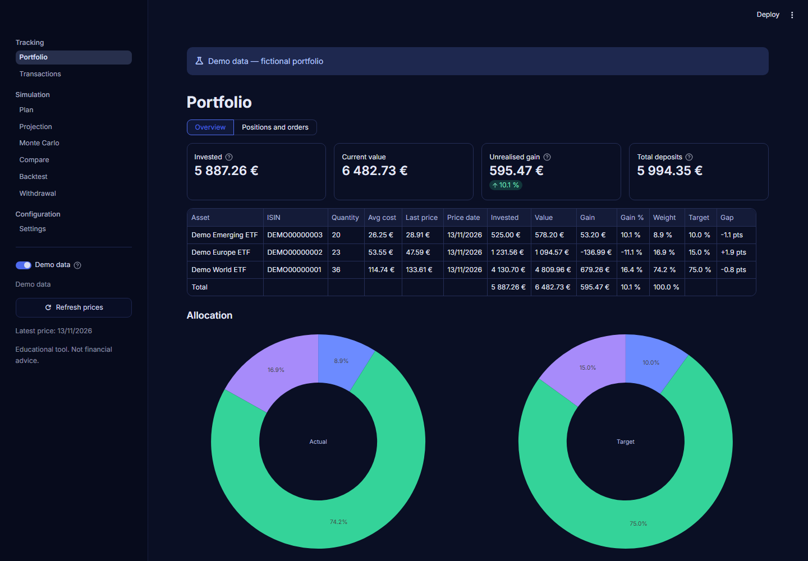
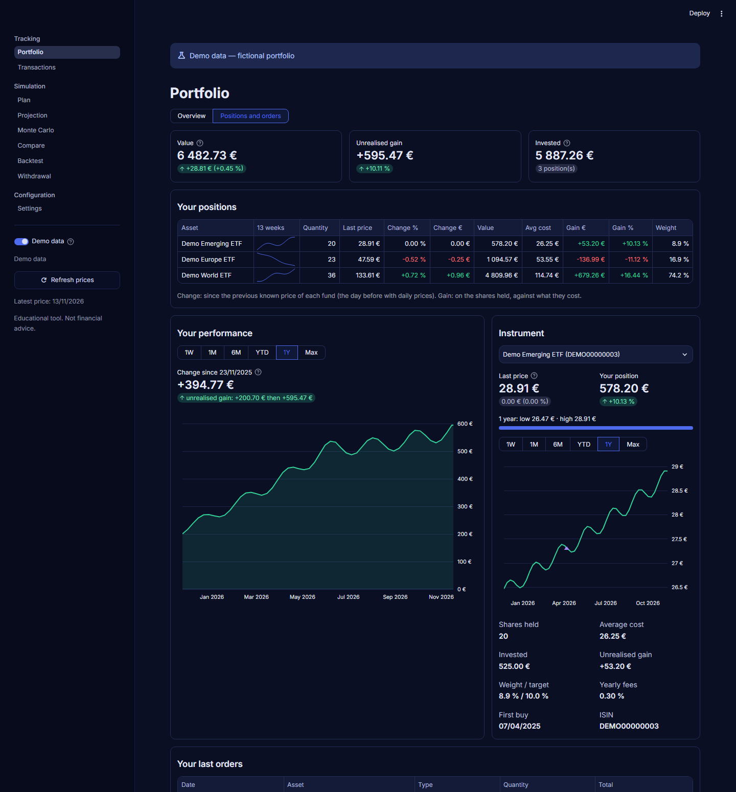
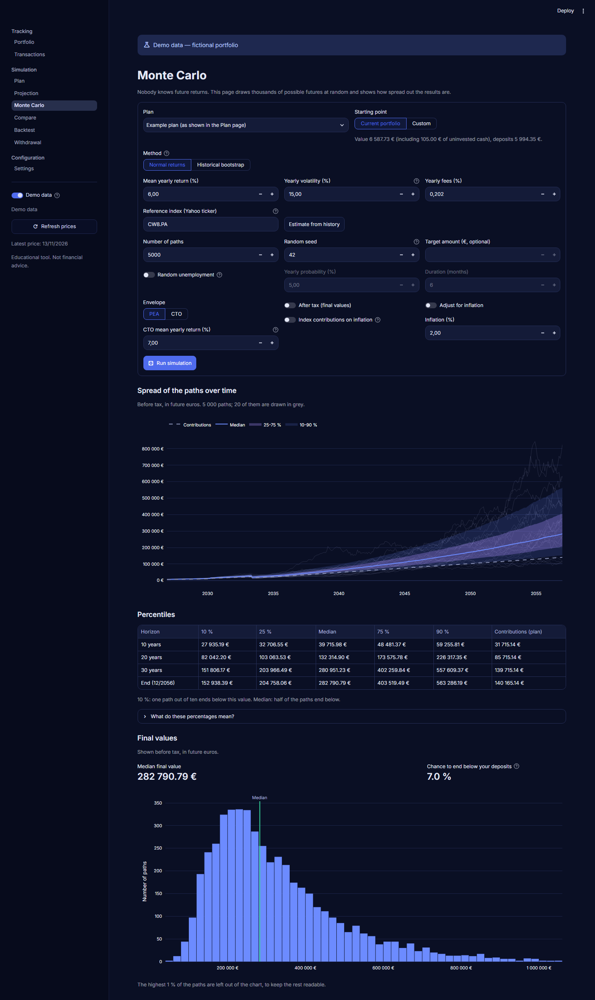
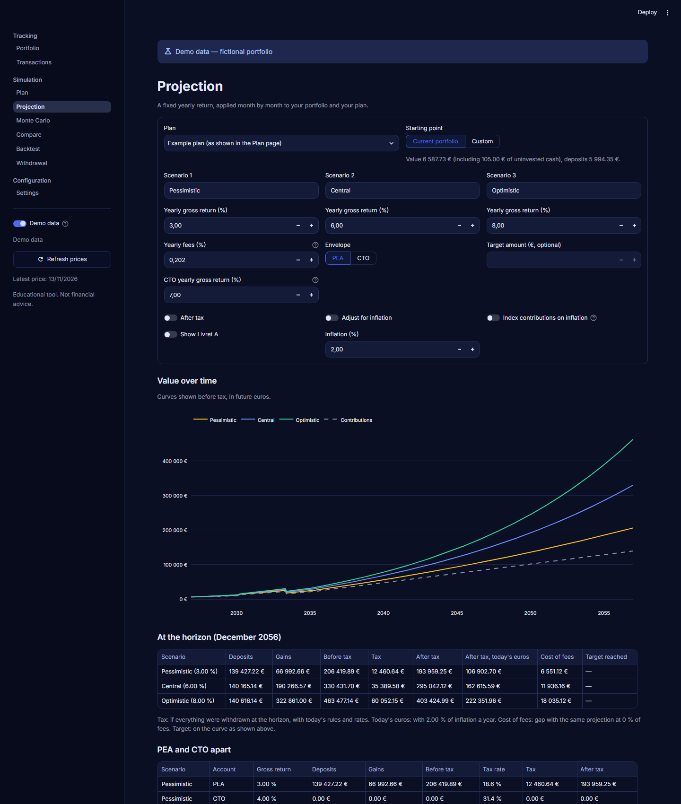
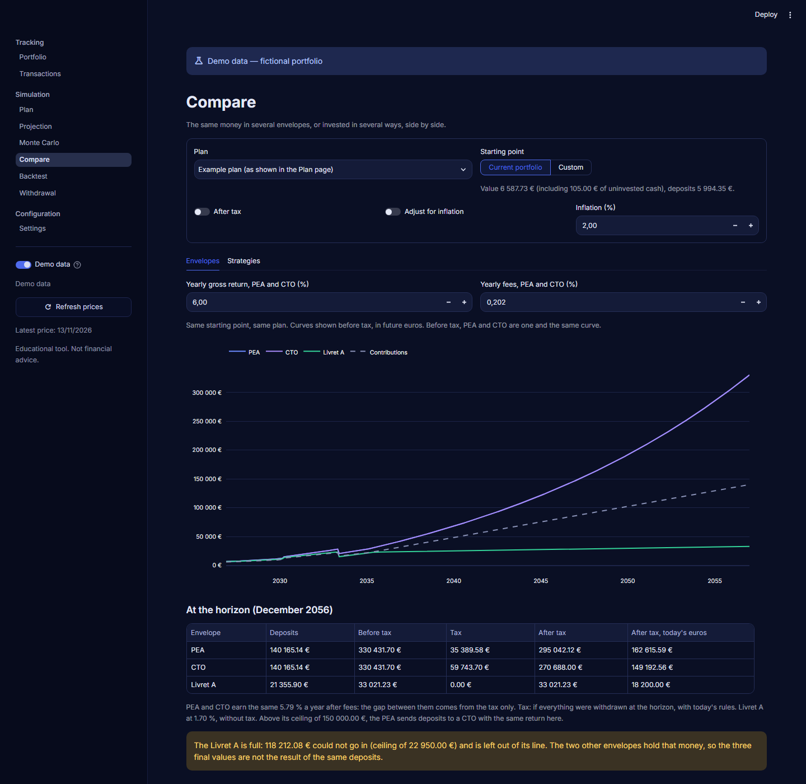
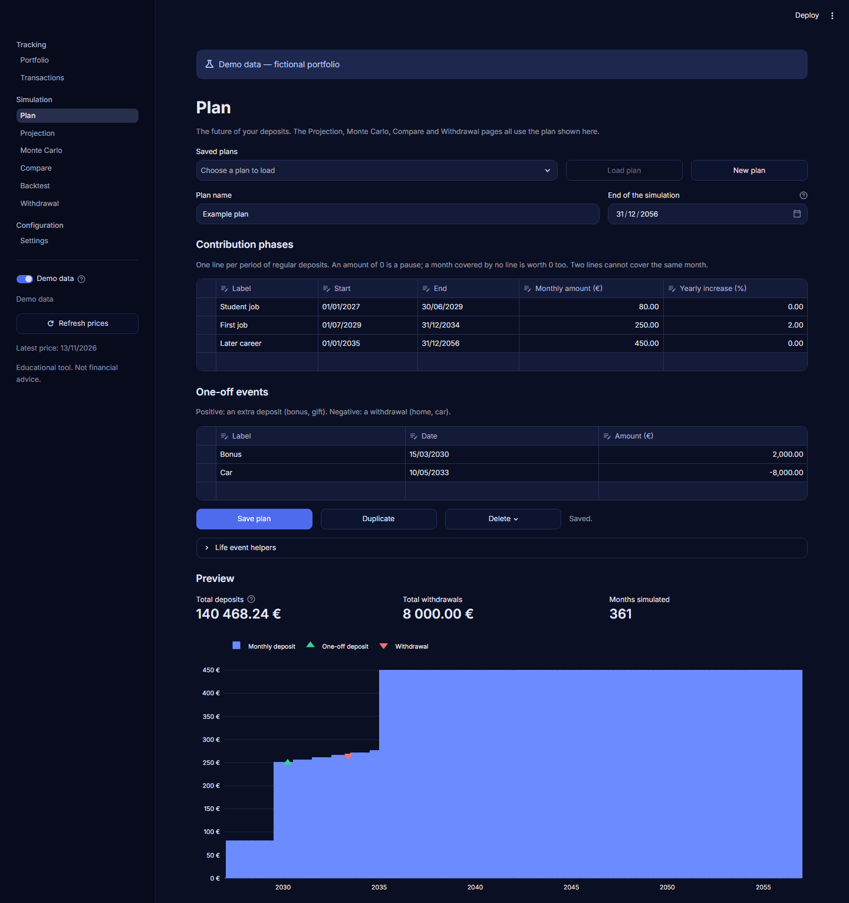

# longterm-invest-simulator

Track a French long-term ETF portfolio (PEA and CTO) and simulate its future: fixed-return
projections, Monte Carlo, historical backtests, comparisons and the withdrawal phase.



**Online demo:** https://longterm-invest-simulator.streamlit.app/ (fictional data only; what you
change is lost when you close the page). The app also opens on fictional demo data when you run
it locally.

## Features

- **Portfolio**: positions with the weighted average cost, value, unrealised and realised gains,
  allocation against target weights, PEA ceiling and five-year date, value history. A detailed
  view adds the change since the previous price, a 13-week trend per fund, the gain over a chosen
  period, one fund's price chart with your buys, and the last orders.
- **Transactions**: buys, sells, deposits and withdrawals, with checks (no sale of shares you do
  not hold, no future date). CSV import with a preview, probable duplicates and line-by-line
  errors; CSV export.
- **Prices**: daily closes from Yahoo Finance, stored locally; manual prices when a fund is not
  on Yahoo.
- **Plan**: future monthly deposits by periods, one-off deposits and withdrawals, and helpers for
  life events (new job, unemployment, child, home or car purchase, windfall).
- **Projection**: three return scenarios, fees, inflation, tax at the horizon, PEA ceiling with
  the surplus going to a CTO, comparison with a Livret A.
- **Monte Carlo**: thousands of random paths (normal returns or a historical bootstrap),
  percentiles, chance of reaching a target, worst fall along the way, random unemployment, and
  plain-words explanations of every number.
- **Compare**: the same plan in a PEA, a CTO and a Livret A; up to four strategies side by side
  (lump sum against monthly deposits, 100 % equities against 60/40).
- **Backtest**: monthly deposits replayed on real past prices, annualised return, worst fall.
- **Withdrawal**: how long a capital lasts under three withdrawal rules, tax on each withdrawal,
  and the chance it lasts with random returns.
- **Settings**: assets, tax rates and Livret A, full backup and restore in one file.

<p>
  
  
</p>
<p>
  
  
  
</p>

## Install and run

Python 3.11 or later.

```bash
git clone https://github.com/zeyglitch/longterm-invest-simulator.git && cd longterm-invest-simulator
pip install -r requirements.txt
streamlit run app.py
```

The app opens on fictional demo data as long as you have entered no trade. Switch off
**Demo data** in the sidebar to enter your own; they are stored in `data/portfolio.db`, which git ignores. Set `LTIS_DEMO=1` to run the
demo only, without ever opening a real database (this is how the online demo runs).

## How the numbers are computed

Short version; every approximation is also written in the app, next to the result it affects.

- **Cost of a position**: weighted average cost. A sale removes shares at that average cost and
  gives a realised gain.
- **Projection**: each month the value grows at the monthly rate equivalent to the yearly return
  (`(1 + r)^(1/12) - 1`, not `r / 12`), then the deposit comes in, then the withdrawal leaves.
  Fund fees lower the return: `(1 + r) × (1 - fees) - 1`.
- **Tax**: a withdrawal holds capital and gain in the same proportion as the whole account; only
  the gain part is taxed. PEA: social charges only after five years, the flat tax before. CTO:
  flat tax. Livret A: none. Rates are settings, checked on the date shown in the app.
- **PEA ceiling**: deposits above it go to a CTO, taxed as a CTO. A withdrawal does not give
  deposit capacity back (assumption).
- **Monte Carlo**: monthly log-returns drawn from a normal law whose drift keeps the average path
  on the chosen return, or drawn among past monthly returns of an index. Months are independent:
  no long crisis is modelled.
- **Backtest and worst fall**: annualised return found by bisection (an internal rate of
  return); falls are measured on the price of one share, not on an account that keeps receiving
  deposits.

## Project structure

```
app.py              entry point: navigation, demo or real data, price refresh
simulator/          calculations, no Streamlit: database, portfolio, prices, taxes, plan,
                    projection, montecarlo, comparison, backtest, withdrawal, importer, charts
views/              one file per page, plus shared helpers (common.py, inputs.py, positions.py)
tests/              pytest, one file per module of simulator/
sample_data/        fictional demo portfolio and an example import file
.streamlit/         theme
```

## Tests

```bash
pip install -r requirements-dev.txt
pytest
ruff check .
```

264 tests. Every financial calculation is checked against a reference value computed
separately (for example 100 € a month for 10 years at 6 % gives 16 247.34 €). Tests never call
Yahoo Finance and never touch your own database.

## Limits

- A simulation is not a forecast: returns are assumptions, and past prices do not predict
  future ones.
- French rules only (PEA, CTO, Livret A), with today's rates. Not modelled: closing a PEA before
  five years, progressive income tax option, dividends of distributing funds, future changes of
  the tax rates.
- Prices come from Yahoo Finance, which can be late or missing for some funds; a manual price
  can always replace them.
- The life events change the deposits only; the app does not simulate a budget.
- Importing a broker's own CSV format is not supported yet: the generic format is described in
  the app and in `sample_data/import_template.csv`.

## About this project

Built as a personal and portfolio project. I used AI assistants (Claude) for planning, code
generation and review, working from a detailed specification I wrote, and I reviewed and tested
every part.

## Disclaimer

Educational tool. **Not financial advice.** The results depend on assumptions you choose; check
tax rules and rates with an official source before making any decision.

## Licence

MIT, see [LICENSE](LICENSE).
